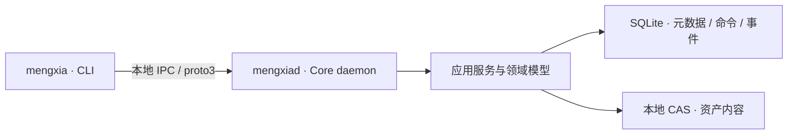

<p align="center">
  
</p>

<h1 align="center">梦夏 Mèng Xià</h1>

<p align="center">
  <strong>本地优先、可自由配置供应商的生成式资产图与生产运行时。</strong>
</p>

<p align="center">
  <a href="#项目概览">项目概览</a> ·
  <a href="#当前进展">当前进展</a> ·
  <a href="#架构与数据模型">架构与数据模型</a> ·
  <a href="#仓库导航">仓库导航</a> ·
  <a href="#开发入口">开发入口</a> ·
  <a href="#文档与参与">文档与参与</a>
</p>

> [!NOTE]
> 项目处于开发阶段。资产管理与创作记录基础已实现，完整生产执行链仍在建设中。
> 当前优先推进 arm64 macOS，Ubuntu 后续独立启动。

## 项目概览

梦夏（Mèng Xià）面向个人创作者、小团队和以 Agent 为主要交互方式的用户，聚焦 AI 短片、广告与视觉内容工作流：把创作意图、素材版本、生成结果和生产历史组织成可持久保存、可追溯的数据，而不把项目身份绑定到某个模型、服务商或文件路径。

项目使用 **Rust** 构建，以 **CLI + Core API** 作为 V1 入口。

### 核心方向

- **资产由用户掌握**：通过本地 Library、SQLite 元数据与受管内容寻址存储（CAS）保存资产；文件内容去重与业务资产身份分开管理。
- **创作过程可追溯**：将项目、主体、场景或镜头、作品修订和候选成果联系起来，保留版本与状态变化。
- **供应商可自由配置**：目标是通过统一的能力与适配器合同连接 CLI、HTTP、本地或混合 Provider，保持核心领域模型稳定。
- **可靠性与安全边界明确**：以持久化命令、事件、恢复流程和受限接口为基础；未满足准入与验证条件的执行能力保持关闭。

V1 范围集中在 CLI + Core API，不包含 Studio UI、时间线编辑器、自有 Agent loop、多用户协作或公共插件市场。

## 当前进展

以下是当前工作区的能力摘要；详细范围和验收证据以[实施计划](docs/spec/IMPLEMENTATION_PLAN.md)及[实现审查](docs/spec/IMPLEMENTATION_REVIEW.md)为准。

| 领域 | 当前状态 |
| --- | --- |
| 工程基础 | 18 个 Cargo workspace package，明确的模块依赖边界、固定工具链与验证脚本 |
| 本地 Library | SQLite 初始化、迁移、所有权与锁、持久化和恢复基础已实现 |
| CLI / Core 通信 | 本地受保护端点、有界 proto3 消息、握手与客户端身份校验已实现 |
| 资产管理 | 复制导入、内容寻址存储、查询、校验、导出副本（materialize）、修订及退役/恢复已实现 |
| 创作记录 | Project、Subject、WorkItem / WorkRevision、Take 及其状态流转已实现 |
| 插件基础 | Manifest 校验、权限差异计算、私有协议及异常协议测试基础已实现；不代表插件安装或运行已开放 |
| Native 执行机制 | 受审查的执行机制正在验证，局部测试证据不代表完整矩阵或产品资格 |
| 后续能力 | Broker 与授权集成、受控工具执行、Recipe / Run、Provider、凭据与网络管理、Rights、GC / Purge 尚未形成完整交付 |

**当前重点：完成受审查的执行机制。** 完整执行矩阵及其 Formal / CI / 产品资格尚未取得，严格隔离路线的 `TASK-012` 仍为 `BLOCKED`。

<details>
<summary>查看验证进度与阶段边界</summary>

当前行动为 `COMPLETE_REVIEWED_EXECUTION_MECHANISM`。最新状态记录了 DATA 编排的部分迁移与审计通过；剩余分段迁移、完整前置条件和 NONLAUNCH 验证仍待完成。

这些未交付能力属于规范明确保留的 `EXPECTED_GAP`。当前验证链有停止与重新启动条件，详见 [AGENTS.md](AGENTS.md) 和[实施计划](docs/spec/IMPLEMENTATION_PLAN.md)；不能根据 README 中的开发命令自行续跑失败批次。

</details>

平台按 **macOS 优先、Ubuntu 后续独立启动**推进。当前开发与已接受验证范围以 arm64 macOS 为主；Ubuntu 尚未交付，本地构建成功也不构成最低系统版本或正式发布支持承诺。

## 架构与数据模型

### 核心架构

当前核心由命令行客户端、守护进程、应用服务和存储适配器组成：



### 三个数据图

目标模型分为三个独立的图，通过明确的关系连接：

| 图 | 主要对象 | 用途 |
| --- | --- | --- |
| 创作意图图 | Project → WorkItem → WorkRevision → Take | 描述要创作什么，以及候选成果如何选择与流转 |
| 资产图 | Asset → AssetRevision → Representation<br>→ Resource → ResourceMember → Blob → Location | 分离业务身份、内容版本、物理字节与存储位置 |
| 执行图（规划中） | Recipe / RecipeRevision / RecipeStep<br>ExecutionPlan → Run → StepRun → Attempt / Job | 描述计划、执行、尝试及恢复历史 |

Core 持有权威状态与存储边界。CLI 和外部 Agent 通过 API 交互，不能直接取得数据库或 CAS 的内部权限。Provider 差异在适配器边界处理。

**技术栈**：Rust 2024 · Tokio · SQLite · Protocol Buffers / proto3 · JSON Schema 2020-12 · Cargo Workspace

## 仓库导航

| 路径 | 内容 |
| --- | --- |
| [`bins/mengxia`](bins/mengxia) | 命令行客户端 |
| [`bins/mengxiad`](bins/mengxiad) | Core 守护进程与服务组合 |
| [`crates`](crates) | 领域、应用、端口、协议、存储、平台及插件基础模块 |
| [`proto`](proto) / [`schemas`](schemas) | 版本化协议和 Manifest Schema |
| [`migrations/sqlite`](migrations/sqlite) | SQLite 迁移 |
| [`scripts`](scripts) | 工具链维护、分层验证和研究脚本 |
| [`docs/spec`](docs/spec) | 规范、决策、审查、实施计划与基线证据 |
| [`docs/proposals`](docs/proposals) | 各阶段设计、准入方案及验证记录 |
| [`docs/development`](docs/development) | 开发环境与维护说明 |

## 开发入口

> [!IMPORTANT]
> 开始前先阅读 [AGENTS.md](AGENTS.md)，并遵守当前阶段的执行范围与停止条件。下列命令不构成续跑失败验证批次的授权。

### 环境准备

完整要求和准备流程见[开发环境与工具维护](docs/development/toolchain-maintenance.md)。

- arm64 macOS 与完整 Xcode；仅安装独立 Command Line Tools 不满足当前开发合同。
- Rust 版本由 [`rust-toolchain.toml`](rust-toolchain.toml) 固定，当前为 `1.98.0`。
- 依赖受 `Cargo.lock` 和供应链策略约束；仓库维护入口使用 locked、offline 构建，需要先具备对应依赖缓存和已验证工具。
- SQLite 使用仓库固定的 bundled 实现，不能以系统 `sqlite3` 替代。

### 构建与查看帮助

在环境准备完成且当前阶段允许执行后，使用仓库入口：

```sh
# 观察开发环境与工具身份
scripts/dev-toolchain.sh inspect

# 构建工作区
scripts/dev-toolchain.sh build

# 查看已构建的 CLI 与守护进程帮助
target/debug/mengxia --help
target/debug/mengxiad --help
```

### 命令导航

| 命令组 | 已实现操作 |
| --- | --- |
| `library` | `status` · `verify` · `issues` |
| `asset` | `ingest-copy` · `list` · `inspect` · `materialize`<br>`create-revision` · `retire` · `restore` |
| `project` / `subject` / `work` / `take` | 项目、主体、作品修订和候选成果的创作记录操作 |

具体参数以 CLI 帮助和相应规范为准。

### 验证入口

| 用途 | 命令 |
| --- | --- |
| 工作区测试 | `scripts/dev-toolchain.sh test` |
| 完整本地门禁 | `scripts/verify-repository.sh developer` |

执行前同样需要满足当前阶段条件。本地结果、历史 CI 证据和新执行机制的资格分别记录，不互相替代。

## 文档与参与

开始分析或修改前，按以下顺序阅读：

1. [实现规范](docs/spec/IMPLEMENTATION_SPEC.md)：目标架构与主要规范依据。
2. [决策日志](docs/spec/DECISIONS.md)：已接受决策、开放问题与冲突。
3. [实现审查](docs/spec/IMPLEMENTATION_REVIEW.md)：可行性、安全边界与阻塞项。
4. [实施计划](docs/spec/IMPLEMENTATION_PLAN.md)：当前阶段、任务依赖与验收条件。
5. [仓库基线报告](docs/spec/PROJECT_INTAKE_REPORT.md)：仓库与工具环境的历史观察证据。

README 是项目概览，不替代上述规范或阶段准入记录。发现规范与实现不一致时，应先记录并按 `EXPECTED_GAP`、`SPEC_STALE`、`REPO_STALE`、`CONFLICT` 或 `UNKNOWN` 分类。

安全问题请遵循 [Security Policy](SECURITY.md)，通过私密漏洞报告渠道提交。
